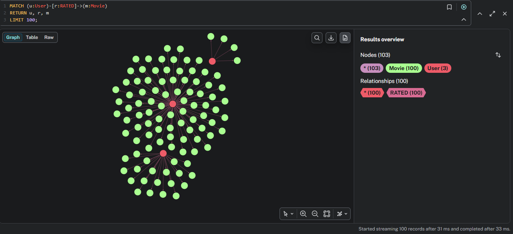

# Primeros días aprendiendo Neo4J y Cypher

Que he aprendido sobre Neo4J (la base de datos de grafos mas conocida) y su lenguaje de consultas Cypher en una semana, con un pequeño avance de mi próximo proyecto: un grafo de vulnerabilidades reales (CVEs) sobre Neo4j.

<!-- more -->

!!! summary "TL;DR (English)"
    One week into Neo4j and Cypher: how graph databases differ from relational ones, basic Cypher queries, and a sneak peek at my upcoming project: a knowledge graph of real CVEs.
    
## Contexto

La base de datos Neo4J Graph es un sistema de gestión de bases de datos implementado en Java y accesible mediante el lenguaje de consulta Cypher.
Este post cubre que he aprendido durante una semana investigando sobre esta base de datos, mis primeras consultas Cypher sobre una base de datos de prueba y un proyecto en el que acabo de empezar a trabajar.

## Diferencia entre bases de datos

Para entender la utilidad de este tipos de bases de datos (bases de datos de grafos) es importante saber las diferencias entre las bases de datos convencionales (bases de datos relacionales como _Postgresql_). A continuación detallo las principales diferencias en una tabla:

| Bases de datos relacionales                                                                                                                                                      | Bases de datos de grafos                                                                                                                                             |
| -------------------------------------------------------------------------------------------------------------------------------------------------------------------------------- | -------------------------------------------------------------------------------------------------------------------------------------------------------------------- |
| Los elementos se almacenan en formato tabular con filas y columnas                                                                                                               | Los elementos se alamacenan como una red de entidades (nodos) y relaciones                                                                                           |
| Todos los datos también se almacenan en tablas y las relaciones entre los datos se almacenan como referencias representadas a la tabla original (las famosas FKs - Foreign Keys) | Las bases de datos de grafos almacenan explícitamente los datos de entidad y relación en lugar de almacenar los datos como referencias                               |
| En tiempo de ejecución, una base de datos relacional usa afirmaciones JOIN para resolver explícitamente estas referencias                                                        | En tiempo de ejecución, una base de datos de grafos aprovecha la teoría matemática de grafos para realizar operaciones de manera eficiente en entidades y relaciones |


Como podemos ver, este tipo de bases de datos es especialmente útil para recorrer relaciones de manera mas rápida y eficiente, y para poder acceder a sus datos de igual manera. Esto es algo que en los útlimos años ha empezado a ganar cada vez mas fuerza, gracias en gran parte a la creciente **Inteligencia Artificial**, tecnología que usa precisamente este tipo de bases de datos gracias a su gestión de relaciones.


## La Base de Datos en cuestión

Vista entonces la utilidad de este tipo de bases de datos para recorrer relaciones, durante esta semana lo que he hecho ha sido descargarme un dataset de prueba en mi _HomeLab_ (del que hablaré en un futuro), instalar Neo4J en un contenedor docker y entender de una manera mas "mecánica" como funciona esta BD.

El dataset que he utilizado lo podéis encontrar en la web de Neo4j, en los ejemplos de datasets que ofrece Neo4j, o en el repositorio que encontrareis en el apartado de referencias (Neo4j Graph Example Movies Recommendation · GitHub).


## Mis primeros pasos con Cypher

Con la base de datos ya en funcionamiento y el dataset cargado correctamente me puse inmediatamente a investigarla y a probar mis primeras querys Cypher. A continuación pongo las que me parecen más útiles para obtener la primera información sobre el dataset:

***Para obtener las etiquetas y el número de nodos por etiqueta que hay***
```cypher
MATCH (n)
RETURN labels(n) AS etiquetas, count(*) AS cantidad
ORDER BY cantidad DESC;
```

***Para obtener las relaciones y el número que hay***
```cypher
MATCH ()-[r]->()
RETURN type(r) AS relacion, count(*) AS cantidad
ORDER BY cantidad DESC;
```

Mientras trabajaba pude ver que sigue una lógica bastante parecida a SQL (lenguaje que he utilizado en la mayoría de bases de datos con las que he trabajado) con la diferencia de que las relaciones se recorren mucho mas facil.



Finalmente, tras mucha práctica y prueba y error saqué algunas consultas que me parecieron muy interesantes para este tipo de bases de datos, y son las de "recomendación". Para este caso en concreto lo que me propuse fue obtener "recomendacioes" de películas a usuarios basadas en los gustos compartidos con otros usuarios. En definitiva, un ejercicio que requería recorrer las relaciones de una manera mas útil que para obtener simplemente las películas que le han gustado a un usuario. A continuación comparto la query que saqué para este caso (con el usuario _Crystal Lane_):

```cypher
// Obtenemos las películas que mas le gustan a nuestro usuario
MATCH (target:User {name: "Crystal Lane"}) -[r1:RATED]-> (liked:Movie)
WHERE r1.rating >= 4

// Obtenemos otros usuarios que les gusten las mismas películas que a nuestro usuario
MATCH (other:User) -[r2:RATED]-> (liked)
WHERE r2.rating >= 4
  AND other <> target

WITH target, other, count(DISTINCT liked) AS sharedLikedMovies

// Obtenemos las películas que les gustan a los otros usuarios y que el nuestro no ha visto
MATCH (other)-[r3:RATED]->(candidate:Movie)
WHERE r3.rating >= 4
  AND NOT EXISTS {
    MATCH (target)-[:RATED]->(candidate)
  }

// Devolvemos las 10 mejores valoradas por los usuarios que comparten gustos
RETURN candidate.title AS pelicula,
       count(DISTINCT other) AS usuariosQueLaRecomiendan,
       max(sharedLikedMovies) AS maxPeliculasCompartidas
ORDER BY usuariosQueLaRecomiendan DESC,
         maxPeliculasCompartidas DESC
LIMIT 10;
```

Este es un ejemplo de lo potente que es esta base de datos para algunos casos, como recomendación de productos.

## El proyecto en el que estoy trabajando actualmente

Habiendo visto entonces ya un poco de Cypher, como funciona la base de datos Neo4J y las muchas posibilidades que tiene, me propuse hacer un proyecto útil, que el centro fuera esta base de datos, con una mejora a futuro de incorporar IA para hacer así un GraphRAG, que investigando un poco he visto que es algo que está en crecimiento.

Así que, con mi afinidad por la ciberseguridad, me propuse hacer una aplicación usando estas tecnologías aplicadas a la ciberseguridad, y así surgió el proyecto [Vulnerability Knowledge Graph](https://github.com/isaiasvela/vulnerability-knowledge-graph). Este proyecto consiste en dos partes bien diferenciadas:
1. Pipeline ETL que ingiere datos del NVD, los procesa y los almacena en una base de datos. Consta de una arquitectura medallion, en la cual obtenemos toda la información y la guardamos en un _json_ (capa _Bronze_), luego la procesamos y guardamos en otro _json_ (capa _Silver_), y finalmente lo añadimos a la base de datos (capa _Gold_).
2. Dashboard, mediante el cual se puede visualizar información de la base de datos. En esta parte es en la que se añadiría la IA, para que pudiera hacer consultas para resolver preguntas.

## Conclusion

En definitiva, esta semana me ha servido para conocer mejor las bases de datos de grafos, entender las diferencias respecto a las bases de datos relacionales y dar mis primeros pasos con Cypher. Aunque todavía me queda mucho por aprender, he podido comprobar de primera mano el potencial que tiene Neo4j, especialmente cuando trabajamos con datos cuya información está estrechamente relacionada.

Lo más interesante de este aprendizaje ha sido poder aplicar los conocimientos adquiridos a un proyecto real relacionado con uno de mis ámbitos de interés: la ciberseguridad. El Vulnerability Knowledge Graph es todavía un proyecto en una fase muy temprana, pero la idea es seguir ampliándolo, mejorar el procesamiento de los datos e investigar cómo incorporar IA mediante un enfoque GraphRAG para poder realizar consultas más complejas sobre las vulnerabilidades y sus relaciones.

Esto no ha sido más que una primera toma de contacto con Neo4j, pero sin duda me ha dejado con ganas de seguir investigando y explorando las posibilidades que ofrecen las bases de datos de grafos. ¡Nos vemos en el siguiente avance del proyecto!

## Referencias
- [Neo4j - Wikipedia](https://en.wikipedia.org/wiki/Neo4j)
- [BD de grafos y relacionales: diferencias entre bases de datos - AWS](https://aws.amazon.com/es/compare/the-difference-between-graph-and-relational-database/)
- [Neo4j Graph Intelligence Platform](https://neo4j.com/)
- [Neo4j Graph Example Movies Recommendation · GitHub](https://github.com/neo4j-graph-examples/recommendations)