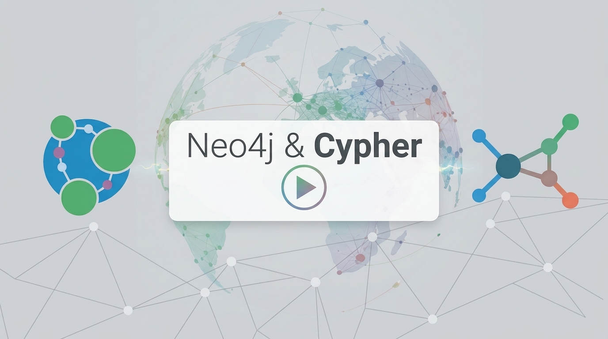
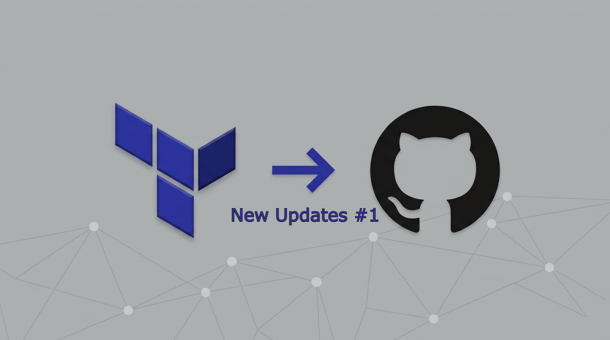

<i></i><i></i><i></i>

visitor@isaiasvela:~$ whoami

Isaías Vela — Ingeniero informático con base en DevSecOps y cloud, ahora enfocado en ingeniería de datos, bases de grafos (Neo4j) e IA.

visitor@isaiasvela:~$ cat mission.txt

Construyo sistemas que conectan datos, personas y tecnología. 

## Sobre mí

Soy ingeniero informático con mención en tecnologías de la información. Mi base está en DevSecOps, cloud security y automatización de infraestructura, y ahora estoy profundizando en ingeniería de datos, bases de grafos con Neo4j y su relación con la inteligencia artificial.

### Áreas de experiencia

DevSecOps
Cloud Security
Kubernetes Security
Data Engineering
Neo4j
Graph Databases
Cypher
IA / RAG

### Enfoque actual

Estoy explorando oportunidades como:

- Data Engineer
- Graph Database Engineer
- AI Engineer

[Ver CV completo →](cv.md)

## Proyectos destacados

Kubernetes

[Kubernetes Security Lab](projects/kubernetes-security-lab.md)

Laboratorio de seguridad hands-on centrado en hardening de Kubernetes, detección en runtime y simulación de ataques.

[Ver proyecto →](projects/kubernetes-security-lab.md)

Terraform

[GitHub Bootstrap](projects/github-bootstrap.md)

Automatización reutilizable para crear repositorios seguros y flujos de trabajo de desarrollo.

[Ver proyecto →](projects/github-bootstrap.md)

[Ver todos →](projects/index.md)

## Últimos writeups de seguridad

Super easy

[Acme](projects/writeups/writeups/acme.md)

De recon a root: banner SSH mal configurado y escalada con setuid.

[Ver writeup →](projects/writeups/writeups/acme.md)

Super easy

[Obsession](projects/writeups/writeups/obsession.md)

FTP anonymous, fuerza bruta SSH y escalada con vim.

[Ver writeup →](projects/writeups/writeups/obsession.md)

[Ver todos →](projects/writeups/index.md)

## Últimas publicaciones

6 de noviembre de 2026

Primeros días aprendiendo Neo4J y Cypher

Lo que aprendí sobre Neo4j y Cypher en una semana: bases de grafos, consultas y un adelanto de mi grafo de CVEs.

[Leer más →](blog/posts/neo4j-y-cypher.md)

30 de septiembre de 2026

Bootstrap de repositorios GitHub, parte 2: de demo a dependable

De demo funcional a herramienta dependable: inputs fail-fast, guardrails de destroy y un workflow a juego.

[Leer más →](blog/posts/github-repository-bootstrap-part2.md)

[Ver todos →](blog/index.md)

## Áreas de interés

- DevSecOps e ingeniería segura
- Cloud y seguridad en Kubernetes
- CI/CD seguro y policy enforcement
- Automatización e IaC para infraestructuras resilientes
- Bases de datos de grafos e Inteligencia Artificil

---

> Este portfolio refleja ingeniería de seguridad práctica, arquitectura segura y mejora continua de sistemas cloud-native.
